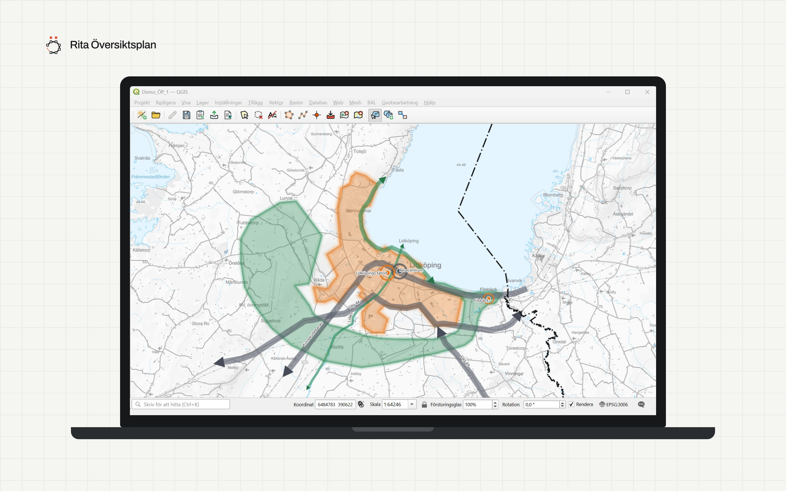

<h1 align="center">
  <picture>
    <source media="(prefers-color-scheme: dark)" srcset="docs/images/banner-mork.svg">
    
  </picture>
</h1>

Ett QGIS-plugin för att **rita översiktsplaner** enligt Boverkets föreskrifter om översiktsplan (BFS 2024:2), Boverkets
[ÖP-modell](https://www.boverket.se/sv/PBL-kunskapsbanken/oversiktsplan/op-modell/) (ÖP-katalogen och GIS-databasmodellen)
och Lantmäteriets [nationella specifikation för översiktsplan](https://www.lantmateriet.se/sv/nationella-geodataplattformen/datamangder/oversiktsplan/)
(testversion), och för att förbereda planen för arkivering. Målgrupp: översiktsplanerare och GIS-ingenjörer hos
kommuner. Syskonplugin till [Rita Detaljplan](https://github.com/ritaplan/rita-detaljplan).

En översiktsplan som påbörjas 1 januari 2027 eller senare ska kunna tillgängliggöras och behandlas digitalt
(plan- och byggförordningen 2 kap. 5 a §). Pluginet gör det arbetet lättare i QGIS.

**Webbsida:** [ritaplan.xyz](https://ritaplan.xyz), om Rita-pluginen.

Öppen källkod, [GPL-2.0-or-later](LICENSE). Gränssnittet är på svenska.

> **Tidig utvecklingsversion.** Läs [Kända begränsningar](docs/kanda-begransningar.md).
>
> Arbete pågår med hur planen visas i kartan: symbologin (färger, kantlinjer och punktsymboler per innehållstyp) och presentationen i övrigt kommer att ändras.

  

## Vad pluginet gör

- **Ritar planen:** *Ny översiktsplan* skapar en GeoPackage med Boverkets GIS-databasmodell (0.3) och värden ur
  ÖP-katalogen 2.2. Rita först och tilldela sedan: rita en yta, linje eller punkt och ge den innehåll med verktyget
  *Tilldela innehåll*. Geometri från andra lager kan importeras i stället för att ritas om, och innehåll kan kopieras
  från ett objekt till andra.
- **Innehåll ur ÖP-katalogen:** innehållstyp, kompletterande innehållstyp, planhändelse och sambandsnivå väljs i
  listor. Det som gäller hela planen ställs in en gång under *Planens uppgifter*. Objektidentitet (UUID),
  versionsdatum och illustrativa gränser fylls i automatiskt.
- **Symbologi per innehållstyp** med detaljplanens färger för mark- och vattenanvändning och övrigt innehåll som
  genomskinliga överlägg. Inga mönster, så att symbolerna fungerar i webbkartor (SLD för GeoServer).
- **Kopplingar:** vilket innehåll som berör annat innehåll (klicka i kartan), riksintressets id och vilket innehåll
  antagandebeslutet gäller.
- **Kontrollerar planen** mot Lantmäteriets specifikation för översiktsplan och visar det som saknas.
- **Levererar till NGP** via Lantmäteriets Uppdatering-API, med valideringsrapporten i en dialog, eller sparar planen
  som JSON-fil.
- **Skapar bokmärken i planhandlingen** (Word): ett eget fönster där textavsnitten granskas och kopplas till planens
  innehåll genom att klicka i en karta. Avsnitten får bokmärken enligt Boverkets instruktion för texthantering.
  Innehåll som bara beskrivs i text kan läggas in utan geometri.
- **Förbereder för arkivering:** arkivpaket med bevarandemetadata enligt Boverkets specifikation för
  långtidsbevarande (PREMIS), och en kontroll av att paketet inte ändrats.
- **Lagrar planen** i en lokal GeoPackage eller i en PostGIS-databas där flera kan arbeta, med **utcheckning och
  incheckning** som i Rita Detaljplan.

## Installera

Kräver **QGIS 4.0 eller senare** (testat med 4.2.2 på Windows).

1. Ladda ned `rita_oversiktsplan-<version>.zip` från [Releases](https://github.com/ritaplan/rita-oversiktsplan/releases).
2. Starta QGIS och välj **Tillägg → Hantera och installera tillägg… → Installera från ZIP**.
3. Peka ut zip-filen och klicka **Installera tillägg**.
4. Under **Installerade** ska *Rita Översiktsplan* vara ikryssat. Verktygsfältet **Rita Översiktsplan** och menyn
   **Insticksprogram → Rita Översiktsplan** visas.

**Eller som egen pluginkälla (då visas uppdateringar direkt i QGIS):**

1. Välj **Tillägg → Hantera och installera tillägg… → Inställningar** och klicka **Lägg till…** under *Pluginkällor*.
2. Ange valfritt namn och som URL
   `https://raw.githubusercontent.com/ritaplan/rita-oversiktsplan/main/plugins.xml`.
3. Kryssa i **Visa experimentella tillägg**, gå till **Alla** och installera *Rita Översiktsplan*.

Vill du köra direkt från källkoden, se [Utveckling](docs/utveckling.md).

## Snabbstart

1. Klicka **Ny översiktsplan** (kartan med grönt plus) i verktygsfältet **Rita Översiktsplan**: välj kommun, skriv
   planens titel och välj mapp.
2. Klicka **Planens uppgifter** och fyll i planhändelsen och standardvärdena för innehåll.
3. Klicka **Rita yta** (eller linje eller punkt) och rita.
4. Klicka **Tilldela innehåll**, klicka på det du ritat och välj grupp och innehållstyp.
5. Klicka **Avsluta redigering** (disketten) och välj **Spara och avsluta**.

Fler detaljer, steg för steg: [Användarhandbok](docs/anvandning.md), även på [ritaplan.xyz/handbok-op.html](https://ritaplan.xyz/handbok-op.html).

## Dokumentation

- [ritaplan.xyz](https://ritaplan.xyz): webbsidan om Rita-pluginen
- [Användarhandbok](docs/anvandning.md): steg för steg genom alla moment och verktyg
- [Datamodell](docs/datamodell.md): tabellerna och var de avviker från Boverkets mall
- [Symbologi](docs/symbologi.md): symbolerna per innehållstyp och varför de ser ut som de gör
- [Kända begränsningar](docs/kanda-begransningar.md): vad som inte är provat eller saknas
- [Utveckling](docs/utveckling.md): köra koden och testerna, struktur
- [Ändringslogg](CHANGELOG.md)

## Bidra

Fel, önskemål och frågor tas emot under [Issues](https://github.com/ritaplan/rita-oversiktsplan/issues). Vill du
bidra med kod, läs [CONTRIBUTING](CONTRIBUTING.md). Säkerhetsfrågor: se [SECURITY](SECURITY.md).

## Licens och källor

GPL-2.0-or-later, se [LICENSE](LICENSE). Material från andra, som Boverkets ÖP-katalog (CC0), står i
[NOTICE](NOTICE.md).

Pluginet är inte en officiell produkt från Lantmäteriet eller Boverket.
